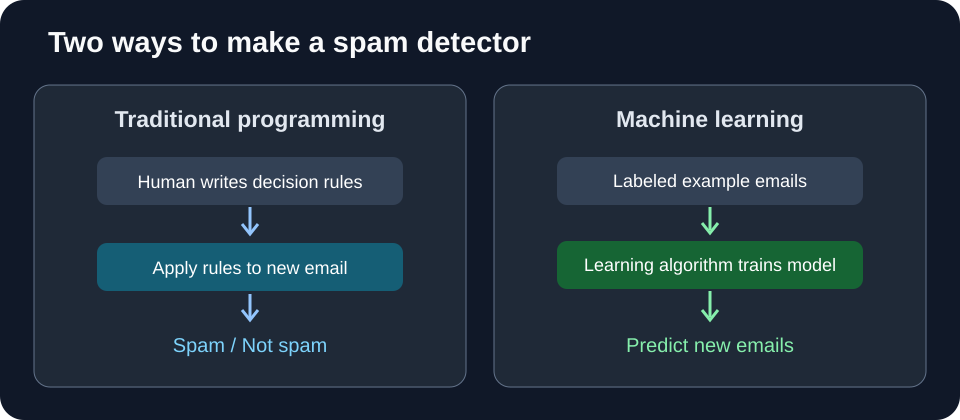

# Lesson 1: What Is Machine Learning?

> **By the end of this lesson, you will be able to:** explain machine learning in your own words, tell it apart from traditional programming, and identify inputs, labels, models, and predictions in an example.

## 1. Start with a familiar problem

Imagine you are building an email app. You want it to warn people about **spam**: unwanted messages such as fake prize announcements.

One way is to write rules yourself:

- If the subject contains *"WIN A FREE PRIZE"*, mark the email as spam.
- Otherwise, let it into the inbox.

This works for that exact phrase. But what if the spammer writes *"Your prize is ready"* instead? Or a genuine friend mentions a prize? Rules that we write by hand can miss cases or make mistakes.

**Machine learning (ML)** takes a different approach: we show a system examples, and an algorithm adjusts it so it can make predictions about new examples.

**The key difference:** in traditional rule-based programming, people explicitly write the decision rules. In machine learning, a **learning algorithm uses data to determine adjustable parts of the decision rule**. Both still involve human decisions about the task, data, and system design.

## 2. What do we show the computer?

Suppose we collect these four emails:

| Email text (input) | Correct category (label) |
|---|---|
| "Claim your surprise prize now" | Spam |
| "We need the slides for tomorrow" | Not spam |
| "You won a free gift today" | Spam |
| "Can we meet after class?" | Not spam |

The **input** is what the computer receives, such as an email's text. The **label** is the correct answer provided for training, such as *Spam* or *Not spam*.

Each labeled email is one **example**. A collection of examples is a **dataset**.

A computer works with numbers, so the text must be represented numerically. For instance, a simple model might use whether certain words appear as **features**. More advanced models learn useful representations of text themselves.

## 3. What is a model?

A **model** is the part of an ML system that turns an input into a prediction.

A model typically contains adjustable numerical values called **parameters**. They influence which predictions the model makes. During training, the learning algorithm adjusts those parameters.

A model is not simply a collection of answers copied from its dataset. We want it to learn useful patterns that also work on **emails it has never seen before**.

## 4. Training is different from using the model

These are two separate stages:

**Training:** provide examples, compare predictions with correct answers, and adjust the model so it improves.

**Inference (using the trained model):** give it a new email and ask for a prediction. It usually does **not** update its parameters from that email unless a separate learning process is set up.

This distinction matters later when you study language models: generating an answer in a chat does not normally mean that the model is retraining itself during that conversation.

## 5. Can ML do things other than detect spam?

Yes. Two common kinds of predictions are:

- **Classification:** choose a category, like *spam/not spam* or *cat/dog*.
- **Regression:** predict a number, like a house price or tomorrow's temperature.

Machine learning is useful when patterns are hard to express as fixed rules. It is **not** necessary for everything: a calculator adding `2 + 3` is already handled reliably by ordinary programming.

## 6. A first look at reliability

What if the spam examples contain only English emails, but real users start receiving spam in another language? Or what if the training labels are wrong?

The model can struggle. **Learning patterns does not guarantee that every prediction is correct.** We'll examine this properly in Lesson 3.

### Quick check

1. In the spam example, what is an **input** and what is a **label**?
2. What is the difference between **training** and **inference**?
3. Why might a model fail on a new email even if it predicted the training examples correctly?

**One-sentence takeaway:** *Machine learning uses data to adjust a model so it can make useful predictions on new inputs.*

**Next:** [Lesson 2 — How Machines Learn](./02-how-machines-learn.md)
