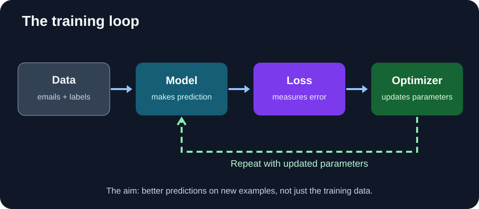
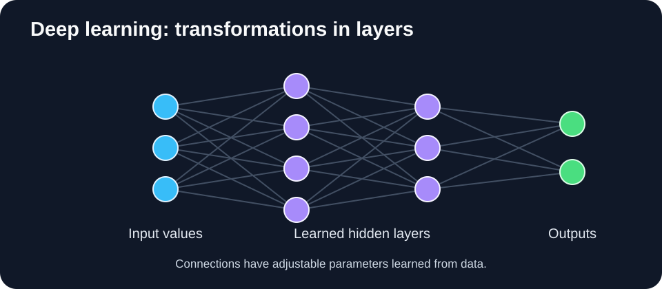
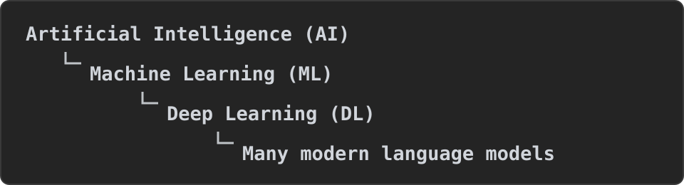

# Lesson 2: How Machines Learn

> **By the end of this lesson, you will be able to:** describe a training loop; recognize supervised, self-supervised, and reinforcement learning; and explain what makes deep learning different.

Last time we built the idea of a spam detector. Now let's look at **how** it becomes better at predicting spam.

## 1. The four ingredients of training

Think of training a model as repeatedly practicing with feedback.

**1. Data:** example emails and, for our spam classifier, their correct categories.

**2. Model:** a system with adjustable **parameters** (numbers that influence its predictions).

**3. Loss function:** a way to measure how poorly the predictions match the training targets. Generally, **smaller loss is better**.

**4. Optimizer:** a method for changing parameters to try to reduce that loss. A widely used family of methods is called **gradient descent**; the mathematics can wait until later chapters.

### Follow one example

Our model sees: **"You have won a free gift."**

- **Correct label:** Spam.
- **Model's first prediction:** Not spam.
- **Feedback:** The prediction is wrong, so the loss indicates an error.
- **Update:** The optimizer changes some parameters to make better predictions on training examples.
- **Repeat:** After many examples and updates, we hope the model also improves on *new* emails.

**Important:** the model does not necessarily get every example right after one update. Updates seek to improve performance over many examples, and they can sometimes make individual predictions worse.

## 2. Three ways models can learn

### A. Supervised learning: examples with answers

Our spam detector is **supervised learning**: each training email comes with a correct label.

Another example is predicting house prices from past house details and sale prices.

### B. Self-supervised learning: make targets from the data

Consider the sentence:

> "The student opened the ..."

A language model might practice predicting the **next token** (a word or part of a word) from the preceding tokens. The target can come directly from the next part of an existing text, without someone manually labeling each sentence.

That is an example of **self-supervised learning**. It is central to how many modern large language models are pretrained. A related task asks models to fill in missing pieces of text.

Self-supervision is not the same as understanding everything correctly; a model can learn useful text patterns and still produce false statements.

### C. Reinforcement learning: actions and rewards

Imagine a robot trying to reach a charging station.

It observes its surroundings, chooses an **action** (move left or right), and receives feedback in the form of a **reward**. Over many attempts, it can learn which actions tend to work well.

**Reinforcement learning (RL)** focuses on learning from this kind of interaction and reward. Some AI-assistant training methods also use reward signals or learned preferences.

> **Also useful to know:** in **unsupervised learning**, we look for structure in data without a predefined answer for every example—for instance, grouping similar articles. We will study methods in later chapters.

## 3. What is deep learning?

**Deep learning (DL)** is a type of machine learning that uses **neural networks with multiple layers** of learned transformations.

A neural network takes numbers as input, processes them through layers of mathematical operations, and produces outputs. It learns by adjusting parameters throughout the network.

For an image-recognition task, some early layers may learn simple visual patterns; later layers can combine these into more complex features. This is an intuition, not a fixed rule that every neural network follows.

**What makes it powerful?** Deep learning can often **learn useful representations directly from data**, reducing the need for humans to hand-design every useful feature.

Modern language models often use a neural network architecture called the **Transformer**, which helps information from different positions in a sequence interact. We will explain attention and Transformers carefully in a later chapter; you do not need their internal mathematics today.

## 4. Where does AI fit?

This shows a useful relationship, **not** that all AI is deep learning: AI also includes systems built with search, explicit rules, and other techniques.

### Quick check

1. Which part of training tells us how far a prediction is from its target?
2. Is predicting the next token from raw text a form of supervised, self-supervised, or reinforcement learning?
3. What is the main difference between machine learning broadly and **deep learning**?

**One-sentence takeaway:** *Training adjusts a model using feedback, while deep learning uses multiple neural-network layers to learn useful representations from data.*

**Next:** [Lesson 3 — When Machine Learning Goes Wrong](./03-when-ml-goes-wrong.md)
