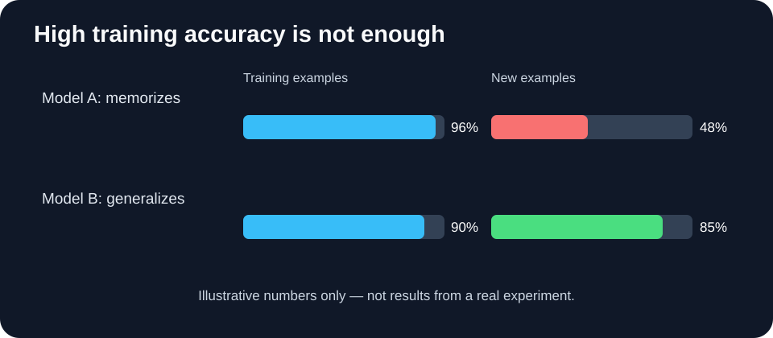

# Lesson 3: When Machine Learning Goes Wrong

> **By the end of this lesson, you will be able to:** explain overfitting and generalization; spot risks from data and changing situations; and describe why AI safety, alignment, and security matter.

A spam detector gets 100% of its training emails right. Does that mean we can trust it on all future emails?

**No.** Getting familiar examples right is not the same as handling new situations well.

## 1. Learning vs. memorizing

Imagine two students studying for a mathematics exam:

- Student A memorizes answers from a practice sheet.
- Student B learns how to solve the kinds of problems on the sheet.

On the practice sheet, both might score highly. On a new exam, Student B has a better chance of adapting.

The ML version of relying too much on training examples is called **overfitting**.

**Generalization** means performing well on examples the model did not train on.

That is why we separate data for **training** and **evaluation**. We train on one set of examples and evaluate on different examples. In larger projects, a **validation** set may help us select models, while a final **test** set is kept separate for a less biased evaluation.

A high score on a small test set is useful evidence, but never a guarantee of safety.

## 2. Three ways our spam detector can fail

### A. Poor or incomplete training data

Suppose every spam message in our dataset says "free gift", while genuine messages never use that phrase. The model may learn a shortcut: **"free" means spam**.

Now a friend emails, "Are you free this evening?" The model might make a wrong prediction.

We should ask: *Does the dataset represent the situations where this model will be used? Are its labels reliable?*

### B. The world changes (distribution shift)

Suppose spammers begin writing messages in new languages, or using new ways to hide malicious links.

The messages the system sees after deployment now differ from the examples it trained on. This is **distribution shift**. A model that previously worked well might deteriorate.

### C. The model optimizes the wrong thing

Imagine judging a spam detector only by how few spam emails reach the inbox. A model could block **every** message and achieve that narrow goal—while making email useless!

This illustrates a problem relevant to AI alignment: **a measurable objective may not fully capture what humans actually want**.

We need to evaluate not just a score, but also errors, unintended behavior, and real-world consequences.

## 3. What about language models and AI assistants?

Modern AI assistants can show related problems:

- **Incorrect answers:** a response can sound confident but be wrong.
- **Unreliable behavior:** a system may fail on unusual or unfamiliar instructions.
- **Prompt injection:** an attacker can place malicious instructions in an email, webpage, or document that an AI assistant is asked to read. If the assistant treats that untrusted text as an instruction, it may take an unintended action.

Not all these failures arise from the same mechanism. Some concern model predictions, while others concern **how the model is connected to tools, data, and permissions**.

## 4. Three fields that study these problems

| Field | Main beginner question | Example |
|---|---|---|
| **Technical AI safety** | How do we evaluate and reduce harmful failures? | Test a model for dangerous mistakes before deployment. |
| **AI alignment** | Does the system pursue what people actually intend? | Avoid optimizing a score in a way that defeats the real goal. |
| **AI security** | Can attackers manipulate the model or the surrounding system? | Prevent untrusted documents from causing unauthorized tool actions. |

These areas **overlap**. For example, a prompt-injection attack is a security problem that can also become a safety problem if the assistant has permission to take risky actions.

## 5. Begin thinking like an AI safety researcher

For any ML system, ask:

1. **Goal:** What should it actually do—and what should it avoid?
2. **Evidence:** How was it tested on examples it had not seen?
3. **Failure:** Where might its data, predictions, or incentives mislead it?
4. **Attack surface:** Who can control the inputs, tools, or permissions?
5. **Response:** How would we detect and respond to a failure?

Notice the distinction between an **observation** ("the model misclassified this email") and a **hypothesis** ("perhaps it relies too much on the word *free*"). A hypothesis needs an experiment before we can claim it explains the behavior.

## 6. Your optional first experiment

Try the [First ML Model notebook](./notebooks/first-ml-model.ipynb). It trains a tiny spam classifier, tests it on new messages, and lets you explore where its predictions fail. It is a learning demonstration—not a safe, production-ready spam filter.

### Quick check

1. Why does a perfect training score not prove that a model will work on new messages?
2. What is one way the spam detector might fail when conditions change?
3. What is the difference between **seeing an unexpected prediction** and **proving why it happened**?

**One-sentence takeaway:** *Making a capable model is only the beginning; we must also test generalization, understand failures, and protect the whole system.*

**You finished Chapter 1!** Next comes the foundational math and programming needed to explain *how* these models work internally.
